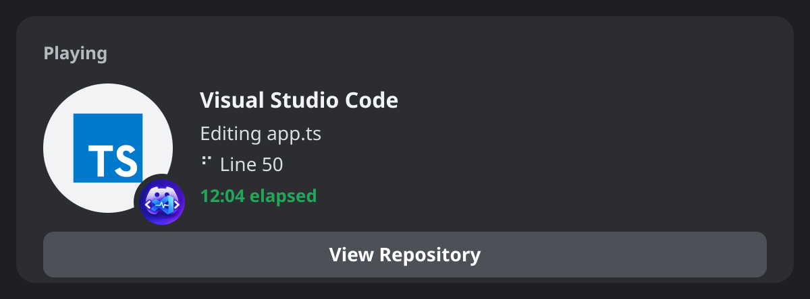
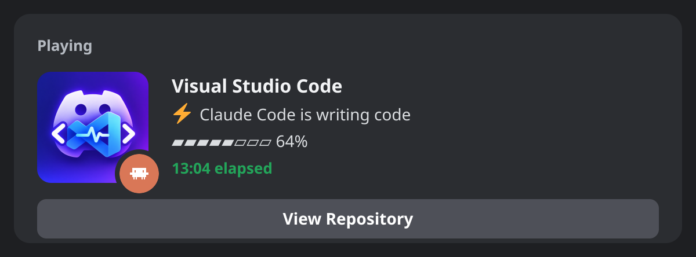
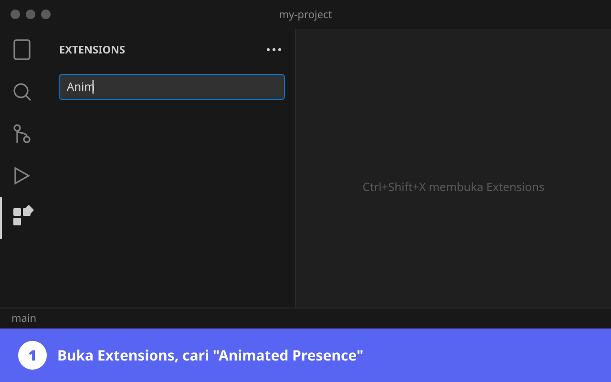
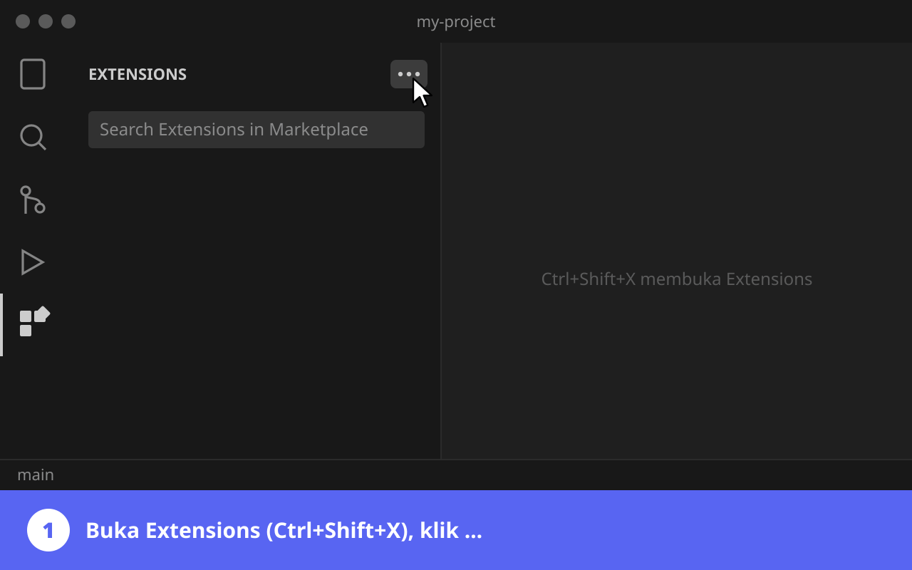

<p align="center">
  
</p>

<h1 align="center">Animated Presence</h1>

<p align="center">
  <b>Discord Rich Presence untuk VS Code yang hidup dan bergerak.</b><br>
  Tunjukkan file yang kamu kerjakan, bahasa yang kamu pakai, dan AI agent yang sedang membantu, lengkap dengan animasi.
</p>

<p align="center">
  <a href="https://github.com/azizuzezo/animated-presence/releases/latest"></a>
  <a href="https://open-vsx.org/extension/xyyxzxx/animated-presence"></a>
</p>

<p align="center">
  <a href="https://github.com/azizuzezo/animated-presence/releases/latest"></a>
  <a href="LICENSE"></a>
</p>

<p align="center">
  
</p>

<p align="center"><i>Contoh tampilan di profil Discord. Frame animasi berganti tiap 15 detik, dan presence ikut berubah saat kamu mengetik atau pindah file.</i></p>

---

## Fitur

- **Tanpa setup.** Install, buka VS Code, dan presence langsung muncul. Tidak perlu login atau konfigurasi apa pun.
- **Teks animatif.** Baris presence bergantian: file → workspace → bahasa → AI agent, dengan spinner dan progress bar `▰▰▰▱▱▱▱▱`.
- **Gambar ikut berganti.** Gambar besar menampilkan ikon bahasa (27 bahasa) dan logo AI agent. Gambar kecil bergantian antara logo dan status aktivitas (*typing*, *reading*, *debugging*, *idle*).
- **Deteksi AI agent.** Presence tahu saat kamu memakai Claude Code, Codex, Copilot, Gemini, Cline, Antigravity, Cursor, dan agent lain.
- **Tombol "View Repository".** Otomatis mengarah ke repo GitHub atau GitLab proyekmu, dan hanya muncul untuk repo publik.
- **Ramah privasi.** Nama file dan workspace bisa disembunyikan, dan workspace tertentu bisa diabaikan.
- **Semua versi Discord.** Discord, Canary, Flatpak, Snap, dan Vesktop di Windows, macOS, dan Linux.

## Contoh tampilan

<table>
  <tr>
    <td align="center" width="50%">
      <br>
      <b>AI agent sedang menulis kode</b><br>
      <sub>Terdeteksi dari <code>claude</code> di terminal, logo Claude di gambar besar.</sub>
    </td>
    <td align="center" width="50%">
      <br>
      <b>Debugging</b><br>
      <sub>Ikon berubah otomatis saat sesi debug aktif.</sub>
    </td>
  </tr>
  <tr>
    <td align="center" width="50%">
      <br>
      <b>Idle</b><br>
      <sub>Setelah 5 menit tanpa aktivitas.</sub>
    </td>
    <td align="center" width="50%">
      <br>
      <b>50 ikon bawaan</b><br>
      <sub>Bahasa, aktivitas, dan AI agent.</sub>
    </td>
  </tr>
</table>

## Instalasi

Pilih sesuai editor yang kamu pakai. Setelah terpasang, **tidak perlu setting apa pun**.

| Editor | Cara install | Waktu |
| --- | --- | --- |
| **Antigravity, Cursor, Windsurf, VSCodium, Trae** | Cari *Animated Presence* di Extensions, klik **Install** | ~10 detik |
| **VS Code** | Download `.vsix` dari [Releases](https://github.com/azizuzezo/animated-presence/releases/latest), lalu **Install from VSIX** | ~30 detik |

### Antigravity, Cursor, Windsurf, VSCodium, Trae

<p align="center">
  
</p>

1. Buka panel **Extensions** (`Ctrl+Shift+X`, di macOS `Cmd+Shift+X`).
2. Ketik **Animated Presence**, lalu klik **Install**.
3. Selesai. Item **Presence** muncul di status bar bawah, tanda sudah terhubung ke Discord.

Ekstensi ini diambil dari [Open VSX](https://open-vsx.org/extension/xyyxzxx/animated-presence), dan update berikutnya akan ditawarkan otomatis.

### VS Code

<p align="center">
  
</p>

1. Download file **`animated-presence-x.y.z.vsix`** dari halaman [Releases](https://github.com/azizuzezo/animated-presence/releases/latest), di bagian **Assets**.
2. Di VS Code, buka panel **Extensions** (`Ctrl+Shift+X`), klik menu **⋯** di pojok kanan atas panel.
3. Pilih **Install from VSIX…**, lalu pilih file yang tadi didownload.
4. Selesai. Item **Presence** muncul di status bar bawah.

<details>
<summary>Atau lewat terminal</summary>

```sh
code --install-extension animated-presence-x.y.z.vsix
```

Ganti `x.y.z` dengan versi yang kamu download.

</details>

### Cek pengaturan Discord

Presence hanya muncul kalau dua hal ini terpenuhi:

- **Aplikasi Discord desktop** sedang berjalan. Discord versi browser tidak bisa menerima presence dari aplikasi lain.
- **User Settings → Activity Privacy → Share your detected activities with others** dalam keadaan aktif.

Belum muncul juga? Lihat bagian [Troubleshooting](#troubleshooting).

## Deteksi AI agent

| Cara deteksi | Agent |
| --- | --- |
| Perintah di terminal VS Code | `claude`, `codex`, `gemini`, `copilot`, `qwen`, `aider`, `opencode`, `cursor-agent`, `q` |
| Tab panel agent yang terbuka | Claude Code, Codex, Copilot, Gemini, Cline, Roo Code, Kilo Code, Continue, Amazon Q |
| File berubah bukan dari ketikanmu | Diatribusikan ke agent terakhir yang terdeteksi atau ekstensi agent yang terpasang |
| Editor bawaan | Antigravity, Cursor, Windsurf, Kiro, Trae |

Agent dianggap aktif selama 2 menit setelah sinyal terakhir. Arahkan kursor ke item **Presence** di status bar untuk melihat agent yang sedang terdeteksi.

## Tombol "View Repository"

Tombol mengarah ke remote `origin` workspace. Format SSH diubah otomatis ke HTTPS.
Secara default tombol **hanya muncul untuk repo publik**, supaya nama repo private tidak bocor.

> Discord tidak menampilkan tombol di presence milikmu sendiri. Hanya orang lain yang bisa melihat dan mengkliknya.

## Pengaturan

Semua pengaturan opsional. Buka **Settings** dan cari `Animated Presence`.

| Setting | Default | Fungsi |
| --- | --- | --- |
| `animatedPresence.enabled` | `true` | Aktif atau nonaktif |
| `animatedPresence.frameInterval` | `15` | Detik antar frame (minimum 15, batas Discord) |
| `animatedPresence.detailsFrames` | `["Editing {file}", …]` | Frame baris pertama |
| `animatedPresence.stateFrames` | `["{spinner} Line {line}", …]` | Frame baris kedua |
| `animatedPresence.largeImageFrames` | ikon bahasa | Frame gambar besar (ikon agent otomatis ikut) |
| `animatedPresence.smallImageFrames` | logo + aktivitas | Frame gambar kecil |
| `animatedPresence.largeImageKey` | logo bawaan | Logo aplikasi (`{logo}`): asset key atau URL gambar |
| `animatedPresence.spinnerFrames` | spinner Braille | Karakter spinner |
| `animatedPresence.showAgent` | `true` | Deteksi AI agent |
| `animatedPresence.agentFrames` | `["🤖 Coding with {agent}"]` | Frame saat agent terdeteksi |
| `animatedPresence.agentWorkingFrames` | `["⚡ {agent} is writing code"]` | Frame saat agent mengedit file |
| `animatedPresence.repoButton` | `"public"` | `public` / `always` / `off` |
| `animatedPresence.repoButtonLabel` | `"View Repository"` | Teks tombol repo |
| `animatedPresence.buttons` | `[]` | Tombol tambahan (maks 2 termasuk tombol repo) |
| `animatedPresence.showFileName` | `true` | Tampilkan nama file |
| `animatedPresence.showWorkspace` | `true` | Tampilkan nama workspace dan tombol repo |
| `animatedPresence.ignoredWorkspaces` | `[]` | Workspace yang tidak ditampilkan |
| `animatedPresence.idleTimeout` | `300` | Detik tanpa aktivitas sebelum idle (`0` = mati) |
| `animatedPresence.idleText` | `"💤 Idle..."` | Teks saat idle |

**Placeholder:** `{file}` `{workspace}` `{language}` `{line}` `{branch}` `{spinner}` `{bar}` `{percent}` `{elapsed}` `{activity}` `{agent}` `{editor}` `{logo}`

<details>
<summary><b>Contoh kustomisasi</b></summary>

```jsonc
{
  "animatedPresence.detailsFrames": ["Editing {file}", "🌿 {branch}", "{language} dev"],
  "animatedPresence.stateFrames": ["{spinner} Line {line}", "{bar} {percent}%"],
  "animatedPresence.spinnerFrames": ["◐", "◓", "◑", "◒"],
  "animatedPresence.agentFrames": ["🤖 Vibe coding with {agent}"],
  "animatedPresence.buttons": [{ "label": "My Portfolio", "url": "https://example.com" }],

  // Mode privasi
  "animatedPresence.showFileName": false,
  "animatedPresence.showWorkspace": false
}
```

</details>

## Perintah

| Perintah | Fungsi |
| --- | --- |
| `Animated Presence: Enable` | Aktifkan presence |
| `Animated Presence: Disable` | Matikan dan hapus presence |
| `Animated Presence: Reconnect to Discord` | Sambungkan ulang (atau klik item **Presence** di status bar) |

## Troubleshooting

<details>
<summary><b>Presence tidak muncul</b></summary>

1. Pastikan aplikasi Discord **desktop** sedang berjalan, bukan versi browser.
2. Aktifkan **User Settings → Activity Privacy → Share your detected activities with others**.
3. Cek ikon **Presence** di status bar. Kalau muncul ikon terputus, klik untuk menyambung ulang.
4. Pengguna Flatpak atau Snap: buka Discord dulu, baru buka VS Code.

</details>

<details>
<summary><b>Tombol "View Repository" tidak terlihat</b></summary>

Discord menyembunyikan tombol di presence milikmu sendiri, jadi cek dari akun lain.
Pastikan juga repo-nya publik, atau ubah `repoButton` ke `"always"`.

</details>

<details>
<summary><b>Animasinya lambat</b></summary>

Discord membatasi update presence sekitar sekali per 15 detik, jadi setiap frame tampil selama 15 detik.
Batas ini berasal dari Discord dan tidak bisa dipercepat.

</details>

## Kredit

- Ikon bahasa: [Devicon](https://devicon.dev) (MIT)
- Logo AI agent: [Simple Icons](https://simpleicons.org) (CC0)
- Emoji di gambar contoh: [Twemoji](https://github.com/jdecked/twemoji) (CC-BY 4.0)

Discord, Visual Studio Code, dan nama atau logo AI agent adalah merek dagang milik pemiliknya masing-masing.
Ekstensi ini tidak berafiliasi dengan mereka.

## Lisensi

[MIT](LICENSE)
